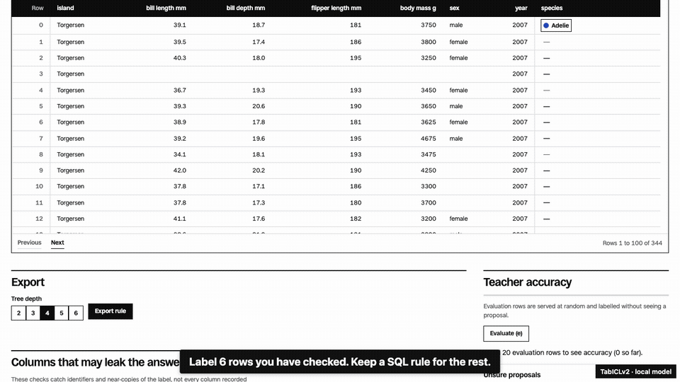

# Rowsetta

Label rows in a local CSV and export the learned decision tree as SQL, dbt,
Python or JSON.

<picture>
  <source media="(prefers-reduced-motion: reduce)" srcset="docs/hero.png">
  
</picture>

Your data stays on your machine. No account or model token is required.

The static browser demo uses **TabICLv2 on Chromium with WebGPU**, with a
labelled lite random forest fallback on other browsers. Build and serve it with
`make browser` and `uv run python -m http.server --directory site`.

## Install and try

In a source checkout, with Python 3.13, uv 0.13.7, Node 26 and pnpm 12.16.1
installed, run:

```sh
make setup
```

Start the bundled penguins demo:

```sh
uv run rowsetta demo
```

The first run downloads the pinned model weights; startup time depends on your
connection. Choose `species` to inspect existing labels, or clear them and label
rows yourself. Review the suggested labels, check the rule on held-out rows and
export it. To use your own CSV, run `uv run rowsetta open data.csv`.

## Evidence and limits

The screenshot uses the Palmer penguins table with labels deliberately changed
by `scripts/mislabel_demo.py`. The audit ranks possible mistakes; a suggestion
is not proof that a label is wrong. Accuracy describes answered evaluation rows;
coverage describes how many rows receive an answer. Both depend on the sample
and do not guarantee performance on future data.

[Benchmark measurements](docs/bench.md) name their scripts and settings. The
committed comparisons are smoke runs, not the full preregistered evidence for
whether the teacher improves on direct decision trees. Do not infer a general
performance advantage from them.

Rowsetta handles classification on CSV files. It samples tables above `10,000`
rows, defaults to a `200 MB` file limit and accepts up to `100` columns
([limits in code](src/rowsetta/core/table.py)). Free-text
columns are skipped. Leak checks find some identifiers and near-copies of the
target, not every post-outcome column.

## Develop

Run `make check` for the local checks. `make dev` serves the frontend at
<http://127.0.0.1:5173> and forwards requests to a local server started with
`uv run rowsetta demo --no-browser --port 8787`. `make build` builds a wheel.
See [development notes](docs/development.md), [architecture](docs/architecture.md)
and [contributing](CONTRIBUTING.md).

## Licence

Code is licensed under [Apache-2.0](LICENSE). Third-party licences and
attributions are retained in [NOTICE](NOTICE). The bundled datasets and their
licences are listed in [datasets/CARDS.md](datasets/CARDS.md). Model weights are
not bundled.
