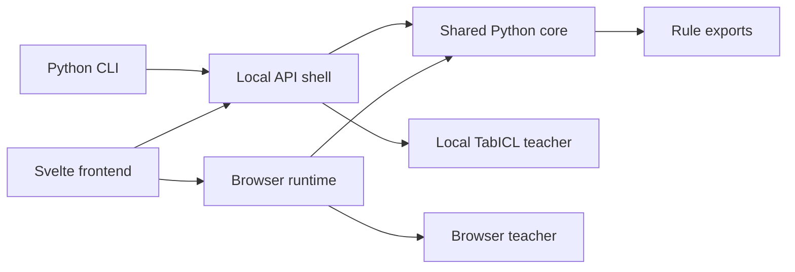

# Architecture

The scaffold contains a command-line entry point and a Svelte page. The core is empty.
The following proposed boundaries are not implemented.

The core must keep filesystem, network, clock and randomness outside its business
logic. The shell owns I/O. Python is packaged with hatchling so frontend packaging can add the
frontend wheel build hook. The browser dependency review remains pending.

See [development notes](development.md) for setup constraints and outstanding inputs.
